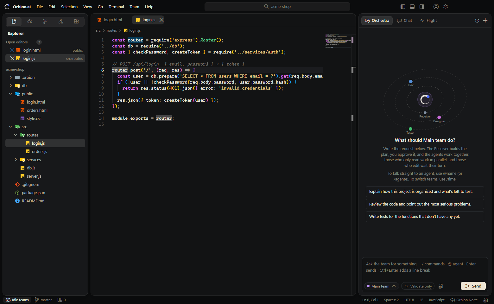
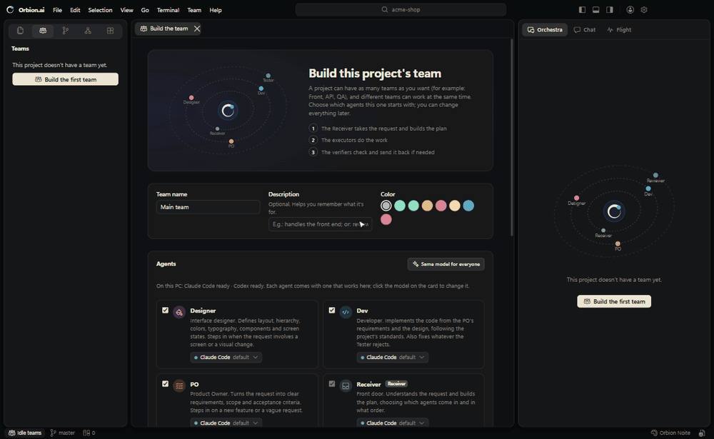
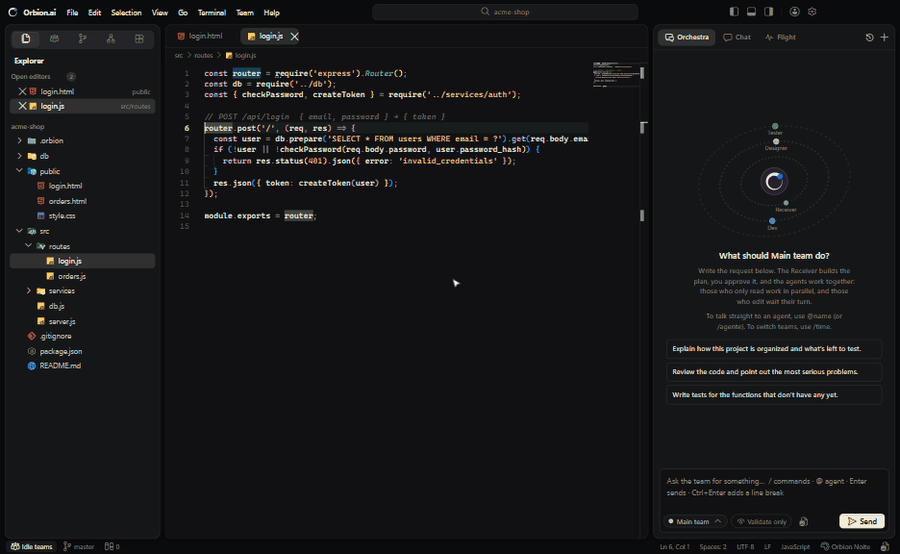
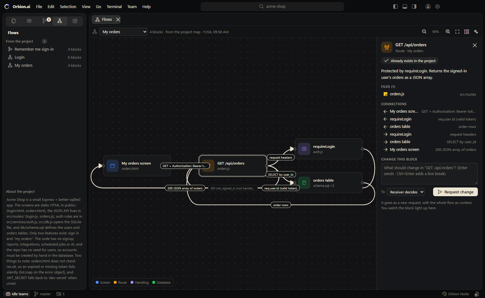
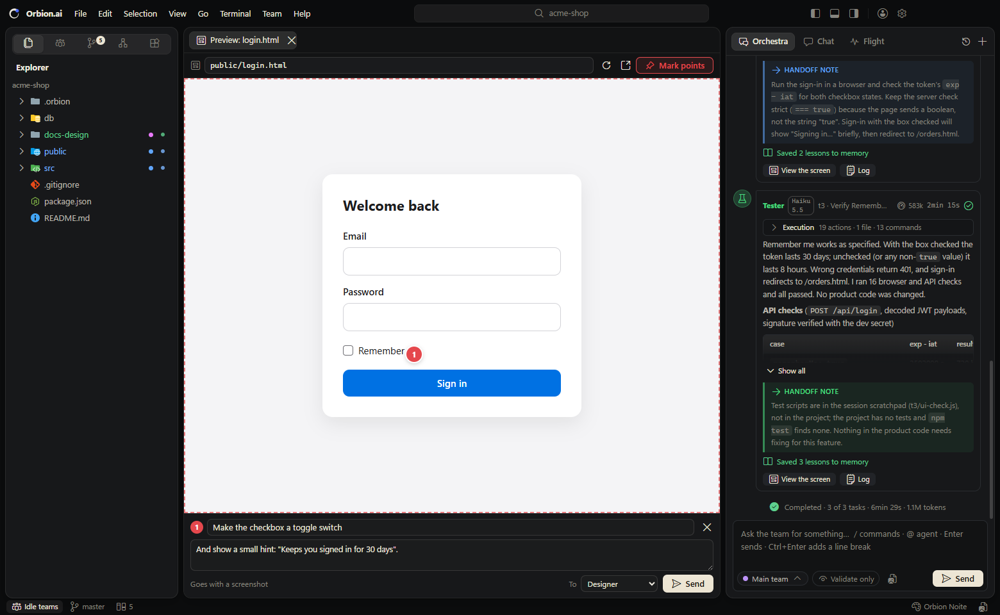

<p align="center">
  <picture>
    <source media="(prefers-color-scheme: dark)" srcset="src/tela/marca/orbion-logo-fundo-escuro.svg">
    
  </picture>
</p>

<h3 align="center">Teams of AIs working together on your project.</h3>

<p align="center">
  A code editor where Claude Code, Codex and API models work as a team:<br>
  one takes the request and plans it, others build, others check, and you watch it all live.
</p>

<p align="center">
  
  
  
  
</p>

<p align="center">
  
</p>

## Download

<table>
  <tr>
    <td align="center" width="33%">
      <br>
      <b>Windows</b><br>
      Windows 10 and 11 · 64-bit<br>
      <sub>version 0.1.0</sub><br><br>
      <a href="https://github.com/dev-lucccaslp/orbion-ai/releases/latest/download/Orbion.ai-windows-x64.exe"><b>Download the installer</b></a><br>
      <sub><code>.exe</code></sub>
    </td>
    <td align="center" width="33%">
      <br>
      <b>macOS</b><br>
      Apple Silicon (M1 or newer)<br>
      <sub>version 0.1.0</sub><br><br>
      <a href="https://github.com/dev-lucccaslp/orbion-ai/releases/latest/download/Orbion.ai-mac-arm64.dmg"><b>Download the app</b></a><br>
      <sub><code>.dmg</code></sub>
    </td>
    <td align="center" width="33%">
      <br>
      <b>Linux</b><br>
      Ubuntu, Debian, Fedora and others · 64-bit<br>
      <sub>version 0.1.0</sub><br><br>
      <a href="https://github.com/dev-lucccaslp/orbion-ai/releases/latest/download/Orbion.ai-linux-x64.AppImage"><b>Download the AppImage</b></a><br>
      <sub>or the <a href="https://github.com/dev-lucccaslp/orbion-ai/releases/latest/download/Orbion.ai-linux-x64.deb"><code>.deb</code></a> for Ubuntu and Debian</sub>
    </td>
  </tr>
</table>

<sub>Every version is in <a href="https://github.com/dev-lucccaslp/orbion-ai/releases">Releases</a>.</sub>

**Before you start**, have at least one engine ready: [Claude Code](https://docs.anthropic.com/claude-code) or [Codex](https://github.com/openai/codex) installed and signed in (Orbion uses your subscription, no API key needed), or an API provider in **Accounts and models**.

<details>
<summary><b>First launch</b> (the installers are not code-signed yet)</summary>

- **Windows**: if you see "Windows protected your PC", click **More info → Run anyway**.
- **macOS**: drag Orbion.ai to Applications. The first time, right-click the app → **Open** → **Open**. If macOS says the app "is damaged", run `xattr -cr /Applications/Orbion.ai.app` in Terminal.
- **Linux**: for the AppImage, `chmod +x Orbion.ai-linux-x64.AppImage` and open it. For the `.deb`, `sudo apt install ./Orbion.ai-linux-x64.deb`.

</details>

## A quick tour

### Build your team

Pick the agents for the project. Each one already comes with an AI model that works on your machine: Orbion checks whether Claude Code and Codex are installed and signed in, and which API providers have a key. Click the model on a card to change it, or use **Same model for everyone**. The orbit shows the team by stage: the Receiver takes the request, the executors build, the verifiers check.

<p align="center"></p>

### Ask, and watch it happen

Write what you want in the Orchestra. The Receiver plans the work and draws the flow of the feature; you approve, and the team gets to work. In the flow, the block each agent is working on lights up with its name, and the screen the Designer builds opens in a preview on its own.

<p align="center"></p>

### The flows of your project

Every feature becomes a flow, n8n style: screen → route → data handling → database → back. The first time you open a project, an AI maps the main flows on its own. Click a block to see what it does, its files and connections, and to ask for a change in that block only.

<p align="center"></p>

### Give feedback on the screen itself

When an agent builds something you can see, it opens in a preview next to the Orchestra. Mark points on the screen, write what should change and send it: the request goes with a screenshot to the agent who built it.

<p align="center"></p>

## What it does

- **Teams in orbit**: the Receiver takes the request and builds the plan, executors (PO, Designer, Dev, DBA...) build, and verifiers (Tester, Reviewer) check and send the work back when needed.
- **Live project flows**: each feature drawn as connected blocks; they light up while the team works.
- **Any AI model**: Claude Code and Codex with your subscription, API models (Gemini, Grok, OpenRouter, OpenCode, Groq, DeepSeek, Mistral, OpenAI) and models that run on your machine (Ollama, LM Studio), free ones included.
- **A real editor**: Monaco (the editor from VS Code), an integrated terminal, git with commit and push, previews of the screens the agents build, and a Chat to think things through before asking.
- **In English, Portuguese and Spanish**, with a Mac look.

## Run from source

Double-click `Orbion.ai.cmd`, or in a terminal:

```
npm start
```

The first time, run `npm install` in this folder.

### Publish a version

- `npm run dist` builds, in `dist/`, the installer for the system you are on.
- For all three systems at once: bump `version` in `package.json` and push a tag with the same number (`git tag v0.1.1` and `git push origin v0.1.1`). GitHub Actions ([release.yml](.github/workflows/release.yml)) builds the installers on Windows, macOS and Linux and publishes them in Releases. The files always have the same name, so the **Download** links point to the new version on their own; just update the version number at the top of this README.
- While the repository is private, only people with access to it can download.

## The window

- **Look**: Mac style. The window is a frame and the panels (sidebar, editor, Orchestra) float on it as rounded cards; menus and notifications are translucent, and the command palette looks like Spotlight. The default theme is **Orbion Noite**.
- **Top**: the app name and the menus (File, Edit, Selection, View, Go, Terminal, Team, Help), search (Ctrl+P for files, Ctrl+Shift+P for commands), the buttons that show or hide the panels, Accounts and models, and Settings.
- **Left**: the view switcher at the top: Explorer (with the icons of the chosen theme), Teams, Changes (git), Flows and Extensions (themes and skills).
- **Center**: the editor, with tabs, syntax highlighting, minimap, Ctrl+S and diffs.
- **Bottom**: the **Terminal** (PowerShell, Git Bash or Command Prompt, several at once, starting in the project folder) and **Live** (each agent's log).
- **Right**: the **Orchestra**, the **Chat** and the **Flight**.
- **Status bar**: who is working, the git branch, line and column, the language, and how much of your Claude limit is used.

## How Orbion.ai gets several AIs to work together

1. **Several teams per project.** Each project has as many teams as you want (Front, API, QA...). Each team has a Receiver, who reads the request and builds the plan, and the agents you pick.
2. **Readers in parallel, one writer at a time.** Agents that only read (PO, Engineer, Reviewer) work at the same time. Agents that edit files queue for the project's write lock, shared by all teams, so two teams can work together without stepping on each other. The Flight shows who is writing and who is waiting.
3. **Lean context.** Each agent gets its task, the handoffs from its teammates and the project memory, not the whole conversation.
   - **One continuous conversation.** In the Orchestra, each new request continues the same conversation with the team. The Receiver (or the agent of a direct request) gets what was already asked and done in it, so you can say "now do the same in…" or "that broke".
   - Each agent shows its **Execution** inside its own message, like Claude Code: what it read, searched, edited, ran and said. It stays open while the agent works and folds when it finishes.
4. **Handoffs.** Each agent finishes by telling what it did, which files it touched and a note for the next one.
5. **Cross review.** Verifiers (Tester, Reviewer) can send the work back to whoever built it, up to a limit of rounds. Put the verifier on a different engine from the builder (Dev on Claude and Tester on Codex, for example): one model catches mistakes the other misses.
6. **Project memory.** What the agents learn (conventions, commands, pitfalls) goes to `.orbion/memoria.md` and into the next requests of every team. You can edit that file.
7. **You decide.** You approve the plan, answer questions and can **step in** on an agent mid-work, from the Flight or the Orchestra: it stops, you say what to do differently, and it starts again with your direction.
   - **Stop**: while the Receiver is planning, the Stop button (in its message, or the square next to Send) stops right away and puts your text back in the box. Use it to fix a badly written request without spending more tokens; that request does not enter the conversation's memory.
   - Once the team is working, "Stop the request" asks for confirmation, because files may have changed already.
8. **Checking is not changing.** The Receiver classifies each request:
   - **Question**: it answers itself.
   - **Verification** ("let's see if…", "check…", "validate…"): the agents only read and query. Nobody edits files, and the verifier does not send anyone back to fix things.
   - **Change**: the full flow.

   The plan approval says which case it is and who will edit. The **Validate only** button in the composer (or `/validar`; `/executar` turns it off) forces a verification until you turn it off.

## Teams and agents

- **Create a team** (Teams view → +, or the Team menu): from the agent templates, with only the Receiver, or copying a team from this or another project. Each team has a name, a color and a description.
- **Each agent's AI model** comes from what exists on your machine: Orbion checks whether Claude Code and Codex are installed and signed in, and which API providers have a key. If an agent's default model is not available (the Tester uses Codex, for example), it switches to one that works and shows **auto**. Click the model on the card to change it, or **Same model for everyone**.
- **The orbit**: Orbion in the center and one ring per stage: the 1st for who takes the request (Receiver), the 2nd for who builds (executors), the 3rd for who checks (verifiers).
- **Agent templates**: Receiver, PO, Designer, Dev, Tester, DBA, Engineer, Reviewer and Documenter, or blank.
- **Edit an agent**: you can change everything.
  - Identity: name, color, icon, order, on or off, and the description.
  - Role: Receiver, Executor or Verifier.
  - Engine: Claude or Codex, the model, the reasoning effort and the time limit.
  - Permissions: whether it can edit files and run commands. On Claude, also the exact list of tools and extra CLI arguments.
  - Skills, the prompt template and the instructions.
  - You can duplicate the agent, copy it to another team, see the assembled prompt or open its `.md` file.
- **Ask**: in the Orchestra, pick the team in the button next to Send. While one team works, you can send another request to another team.

## Accounts and models

The person button at the top (or Help → Accounts and models).

- **Subscriptions**: shows whether Claude Code and Codex are connected and with which account. Connect, Sign out and Install run the command in the terminal below.
- **Models by API key**: pick a provider, paste the key and click Save and test. The test fetches the provider's models (free ones first). The key is encrypted by the operating system and never shown again.
  - **Free**: OpenCode (big-pickle, glm-5.3-flash-free and others; get the key at opencode.ai/console), OpenRouter's `:free` models and the free tiers of Gemini (Google AI Studio) and Groq.
  - **On your machine, no key**: Ollama and LM Studio.
  - **Other**: any service that speaks the OpenAI API format.
- **Each agent picks its engine** in its editor: Claude Code, Codex or a registered provider, and the model with its version (Fable 5.1, Opus 5.5, Sonnet 5.5, Haiku 5.5, GPT-6-Astra...). With API models, Orbion itself provides the tools: reading, listing and searching files always; writing and running commands according to the agent's permissions. The model must support tools (function calling).
- **Who answers the chats, the suggestions and the skills** is also chosen there.
- **GitHub**: the GitHub CLI (`gh`) account. Connect shows a code in the terminal and opens GitHub in the browser. The card also shows the name and email commits are made with.

## Changes (git)

Works like VS Code's Source Control:
- **Top**: the current branch, with the list to switch or create one, and its remote branch.
- **Commit message**: the star asks the AI to write the message from the changes, and Ctrl+Enter commits. The Commit button's menu also has "Commit and push" and "Commit and sync". If nothing is staged, Commit offers to stage everything.
- **Staged** and **Changes**:
  - Clicking a file opens the before and after of that side.
  - Hovering shows open, stage (+), unstage (−) and discard. Discard asks for confirmation, and a new file goes to the trash.
- **Bottom button**: changes with the situation, like in VS Code: "Publish to GitHub" (no remote), "Publish branch" (new branch) or "Sync 1↓ 2↑".
- **Status bar**: the branch (click to switch) and the same sync.
- **More actions (⋯)**: pull, push, fetch, stage, unstage and discard all, and open on GitHub.
- **Project without git**: "Initialize repository" or "Publish to GitHub". "Publish to GitHub" starts git, makes the first commit and creates the repository (private or public) through the GitHub CLI.

## Screen previews

When an agent creates or changes something you can see, the screen it built opens in a tab next to the Orchestra.
- **Where it comes from**: in the `previa` field of its handoff, the agent points to an `.html` in the project or to the `http://localhost:PORT` of a server already running. If it does not point to one but created an `.html`, Orbion uses that.
- **The Designer**: for a new screen or a big visual change, it also makes a prototype in `docs-design/prototipos/<screen>.html`, just to look at.
- **In the tab**: the preview reloads on its own when files change. The bar has the address, reload and open in the browser. It also opens from the **View the screen** button in the agent's message, from View → Preview a screen… or with `/previa`.
- **Give feedback**:
  - write what should change and, if you want, turn on **Mark points** and click on the screen. Each numbered point gets its own comment;
  - **Send** creates a request in the same conversation, with a screenshot of the preview including the points;
  - the request goes to whoever touched the file, or to the Receiver (when whoever showed it only specified it, like the Designer). "To" lets you pick another agent.
- **Security**: the preview is served only on this machine (127.0.0.1), behind a random code in the path. Hidden folders and files (`.git`, `.orbion`, `.env`) are never served.

## Chat, skills and tools

- **Chat** (tab in the right panel, Ctrl+L): talk about the project with an AI that reads the files but changes nothing. Pick the mode (a skill) and who answers. An answer becomes a request for the team with **Turn into request**.
- **Images**: in both chats, paste with Ctrl+V (a screenshot, for example), drag into the box or use the image button. Up to 8 per message, up to 10 MB each (PNG, JPG, GIF or WebP). They are kept in the project's `.orbion/anexos`, which git ignores. Each agent gets them its engine's way: Claude opens the image from its path, Codex gets it with `-i` and API models get it inside the message (the model needs vision). Click an image to enlarge it.
- **History** (clock at the top of the Orchestra and the Chat): each tab's conversations, grouped by Today, Yesterday, Last 7 days…, with search and delete. Nothing disappears: when you open the project, each tab comes back to its last conversation, and + starts a new one.
- **Grill-me** (Team menu, or `/grill` in the request): the AI questions you in rounds, each question with a recommended answer, until the plan is clear. The summary becomes a request.
- **Skills that come with Orbion**: grill-me, planejar-projeto, sugerir-melhorias, revisao-seguranca, tdd, criar-skill and explicar-projeto. Orbion also finds your Claude Code, Codex and plugin skills. They show up in the Extensions view, in the agent editor and in the Chat modes.
- **Create a skill** (Team → Create skill): write it by hand, or describe the idea and click Write for the AI to build the SKILL.md. Save it in the project (`.claude/skills`, which Claude Code also uses) or for every project (`~/.orbion/skills`).
- **Improvement suggestions** (Team → Improvement suggestions, or `/melhorias`): an AI reads the project and returns what is most worth improving, by impact and effort. Each item comes with a ready request for the team, or to discuss first in grill-me.
- **New project** (File menu): name, folder, description and a starting point (empty, Node.js, static site or Python), with git and the default team. After creating it, the team builds the start, or you talk it over first in grill-me.
- **Discover** (Help menu): Orbion's skills and yours, and community ideas from claudemod.com (skills, mods, MCP servers), with a link for each category.

## Project flows

How each feature works end to end (screen → route → data handling → database → back), drawn as connected blocks, n8n style. Open it from the **Flows** view, View → Project flows or Ctrl+Shift+F.
- **The first time a project opens**, an AI reads it (cheaply: it looks for routes, screens and tables instead of reading everything) and maps the main flows. You can turn this off in Settings and redo it with the map button.
- **On each change request**, the Receiver draws the flow in the plan and says which blocks each task builds; the agents return the blocks they built in their handoff, with the real files. The tab opens on its own when the plan arrives.
- **Live**: the block an agent is working on pulses with its name and the connections flow; what is done gets a check, and what is still only planned is dashed.
- **Clicking a block** shows what it does, its files (they open in the editor), its connections, the request's tasks and, for a screen, **View the screen**. When the team is done, **Request change** there sends a new request about that block only, with the whole flow as context, to whoever built it or to the Receiver.
- **Arrange**: drag the blocks (positions are saved), mouse wheel to zoom, double-click to fit everything.

## Languages

Orbion speaks **English, Portuguese and Spanish** (Settings → Appearance → Language, or View → Language…). It starts in the system's language.
- The whole interface switches, including menus, notifications and system dialogs. Code, files, the terminal and what the AIs write stay as they are.
- The agents, the Chat and the flow map answer in the chosen language, even with prompts you edited.
- The translations live in `src/tela/i18n/en.js` and `es.js`: the key is the Portuguese text and the value is the translation.

## Themes and extensions

- The app reads the color and icon themes of the VS Code and Cursor extensions installed on your machine (Dracula, Material Icon Theme...). It also ships three themes of its own: Dracula, Orbion Noite and Orbion Dia.
- In the **Extensions** view you search and install themes straight from **Open VSX** (open-vsx.org), the open registry used by VSCodium and Cursor. Microsoft's Marketplace may only be used by Microsoft products. Downloads are verified with Open VSX's SHA-256 signature. For now, Orbion.ai only uses the themes from extensions.

## Where things live

- `<project>/.orbion/times/<team>/time.json` and `agentes/*.md`: the teams and agents.
- `<project>/.orbion/prompts/`: your custom prompt templates.
- `<project>/.orbion/memoria.md`: the project memory.
- `<project>/.orbion/fluxos.json`: the project flows (blocks, connections, where you arranged each block).
- `<project>/.orbion/config.json`: the workflow (approval, parallel, memory, rounds, time, tasks per plan).
- `<project>/.orbion/execucoes/<date>/`: the record of each request. For each agent: the prompt it got, the exact command and the answer.
- `<project>/.orbion/conversas/`: the chats. `<project>/.orbion/melhorias.json`: the latest improvement analysis.
- `<project>/.claude/skills/` and `~/.orbion/skills/`: the skills you create.
- `~/.orbion/extensoes/`: the extensions installed by the app.
- `%APPDATA%\Orbion.ai\config.json`: recent projects, language, theme, font, default terminal, layout and who answers the chats.
- `%APPDATA%\Orbion.ai\provedores.json`: the API providers, with the key encrypted. The key can also come from an environment variable `ORBION_CHAVE_<ID>` (e.g. `ORBION_CHAVE_OPENROUTER`).

## Shortcuts

| Shortcut | What it does |
|---|---|
| Ctrl+I | New request |
| Enter / Ctrl+Enter | In the chats: send / new line (Shift+Enter also adds a line) |
| Ctrl+Shift+V | Flight |
| Ctrl+L | Chat |
| Ctrl+Shift+F | Project flows |
| Ctrl+´ | Show or hide the terminal |
| Ctrl+Shift+´ | New terminal |
| Ctrl+P | Find a file |
| Ctrl+Shift+P | Commands |
| Ctrl+S | Save |
| Ctrl+W | Close tab |
| Ctrl+B | Sidebar |
| Ctrl+J | Bottom panel |
| Ctrl+Alt+B | Right panel |
| Ctrl+Shift+E / T / G / X | Explorer / Teams / Changes / Extensions |

## Good to know

- **Plan usage**: each agent is a call to Claude or Codex, and two teams at once use twice as much. The Flight and the status bar show how much is used.
- **Tokens**:
  - **Where they show**: in each agent's header (live while it works), on the closing line of each request, on the Flight cards and on each Chat answer. Hover to see the split: fresh input, cache read, cache written and output.
  - **What weighs**: every Claude Code call starts with about 10 to 15 thousand fixed tokens (its prompt and Orbion's), almost all from cache. So making fewer calls saves more than writing short requests.
  - **How to save**: a direct request with @agent (skips the Receiver), Validate only (1 or 2 tasks, no review), a smaller model for simple agents (Haiku 5.5) and fewer tasks and rounds in the project settings.
- **No confirmations for commands**: agents with permission run commands and edit files without asking. Use it on projects under git, so you can undo.
- **No time limit**: each agent works until it is done. If you want a limit, set it in the project settings or in the agent editor (empty or 0 means no limit). To stop earlier, use Stop.
- **A folder with several projects** (like a monorepo): Orbion recognizes the subfolders that are projects and tells the Receiver and the agents. Everything they create goes inside the request's project, never loose at the root. Design goes in `<project>/docs-design/<topic>.md` and architecture in `<project>/docs-arquitetura/<topic>.md`.
- **Isolation**: Claude agents run without your connectors, plugins and hooks.
- **API models**: each step is a call to the provider, which charges per token (except free and local ones). Small models sometimes get tool use wrong; for editing code, prefer a strong model.
- **Codex**: the Tester and the Reviewer come with the `gpt-6-astra` model, because the command-line Codex rejects the model in your `config.toml` when signed in with a ChatGPT account.

## Without the window

```
node src/cli.js <project-folder> "what you want" [--time <id>] [--auto]
```
