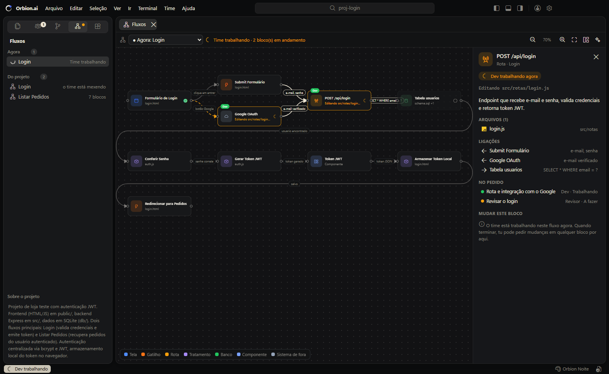
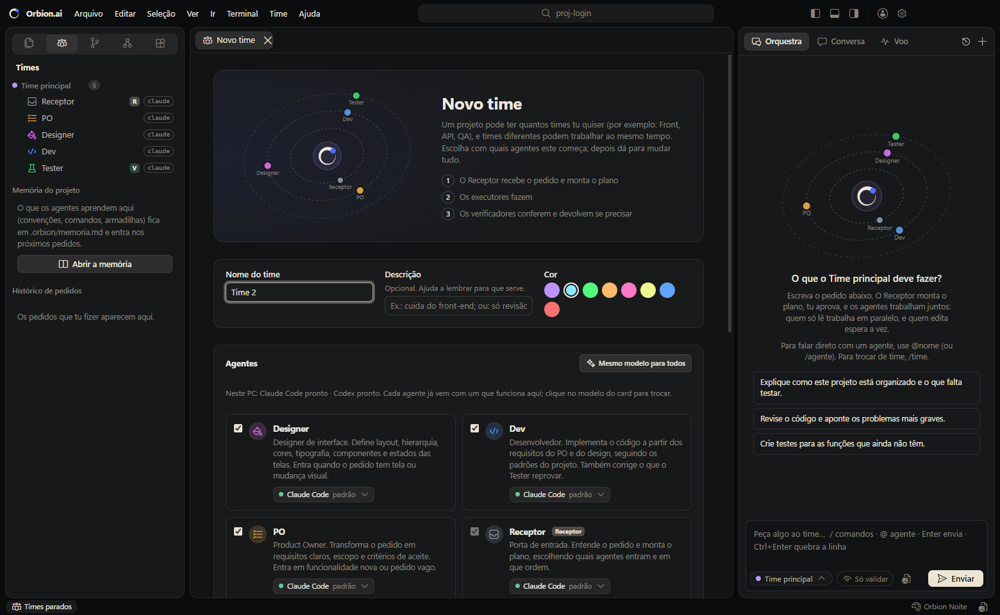

<p align="center">
  <picture>
    <source media="(prefers-color-scheme: dark)" srcset="src/tela/marca/orbion-logo-fundo-escuro.svg">
    
  </picture>
</p>

<h3 align="center">Times de IAs trabalhando juntos no teu projeto.</h3>

<p align="center">
  Um editor de código onde o Claude Code, o Codex e modelos por API se organizam em times:<br>
  um recebe o pedido e monta o plano, outros fazem, outros conferem, e tu acompanha tudo ao vivo.
</p>

<p align="center">
  
  
  
  
</p>

<p align="center">
  
</p>

## Baixar

<table>
  <tr>
    <td align="center" width="33%">
      <br>
      <b>Windows</b><br>
      Windows 10 e 11 · 64 bits<br>
      <sub>versão 0.1.0</sub><br><br>
      <a href="https://github.com/dev-lucccaslp/orbion-ai/releases/latest/download/Orbion.ai-windows-x64.exe"><b>Baixar o instalador</b></a><br>
      <sub><code>.exe</code></sub>
    </td>
    <td align="center" width="33%">
      <br>
      <b>macOS</b><br>
      Apple Silicon (M1 ou mais novo)<br>
      <sub>versão 0.1.0</sub><br><br>
      <a href="https://github.com/dev-lucccaslp/orbion-ai/releases/latest/download/Orbion.ai-mac-arm64.dmg"><b>Baixar o app</b></a><br>
      <sub><code>.dmg</code></sub>
    </td>
    <td align="center" width="33%">
      <br>
      <b>Linux</b><br>
      Ubuntu, Debian, Fedora e outros · 64 bits<br>
      <sub>versão 0.1.0</sub><br><br>
      <a href="https://github.com/dev-lucccaslp/orbion-ai/releases/latest/download/Orbion.ai-linux-x64.AppImage"><b>Baixar o AppImage</b></a><br>
      <sub>ou o <a href="https://github.com/dev-lucccaslp/orbion-ai/releases/latest/download/Orbion.ai-linux-x64.deb"><code>.deb</code></a> para Ubuntu e Debian</sub>
    </td>
  </tr>
</table>

<sub>Todas as versões ficam em <a href="https://github.com/dev-lucccaslp/orbion-ai/releases">Releases</a>.</sub>

**Antes de abrir**, deixe pelo menos um motor pronto: o [Claude Code](https://docs.anthropic.com/claude-code) ou o [Codex](https://github.com/openai/codex) instalado e logado (o Orbion usa a tua assinatura, sem chave de API), ou um provedor por token em **Contas e modelos**.

<details>
<summary><b>Primeira abertura</b> (o instalador ainda não tem assinatura digital)</summary>

- **Windows**: se aparecer "O Windows protegeu o computador", clique em **Mais informações → Executar assim mesmo**.
- **macOS**: arraste o Orbion.ai para Aplicativos. Na primeira vez, clique com o botão direito no app → **Abrir** → **Abrir**. Se o macOS disser que o app "está danificado", rode `xattr -cr /Applications/Orbion.ai.app` no Terminal.
- **Linux**: no AppImage, `chmod +x Orbion.ai-linux-x64.AppImage` e abra. No `.deb`, `sudo apt install ./Orbion.ai-linux-x64.deb`.

</details>

## O que ele faz

- **Times em órbita**: o Orbion no centro e um anel por etapa. O Receptor recebe o pedido e monta o plano, os executores (PO, Designer, Dev, DBA...) fazem, e os verificadores (Tester, Revisor) conferem e devolvem se precisar.
- **Fluxos do projeto, ao vivo**: cada funcionalidade vira um fluxo no estilo do n8n (tela → rota → tratamento → banco). Enquanto o time trabalha, o bloco em que cada agente mexe acende; depois, um clique no bloco pede uma mudança só nele.
- **Qualquer modelo de IA**: Claude Code e Codex com a tua assinatura, modelos por token (Gemini, Grok, OpenRouter, OpenCode, Groq, DeepSeek, Mistral, OpenAI) e modelos que rodam no teu PC (Ollama, LM Studio), inclusive os grátis. Cada agente já vem com um que existe na tua máquina.
- **Um editor de verdade**: o Monaco (o mesmo do VS Code), terminal integrado, git com commit e push, prévia das telas que os agentes constroem, e uma Conversa para pensar antes de pedir.
- **Em português, inglês e espanhol**, com cara de Mac.

<p align="center">
  
</p>

## Rodar pelo código

Dois cliques em `Orbion.ai.cmd`, ou no terminal:

```
npm start
```

Na primeira vez, rode `npm install` nesta pasta.

### Publicar uma versão

- `npm run dist` gera, em `dist/`, o instalador do sistema em que tu está.
- Para os três sistemas de uma vez: aumente a `version` no `package.json` e suba uma tag com o mesmo número (`git tag v0.1.1` e `git push origin v0.1.1`). O GitHub Actions ([release.yml](.github/workflows/release.yml)) monta os instaladores no Windows, no macOS e no Linux e publica tudo em Releases. Os arquivos têm sempre o mesmo nome, então os links de **Baixar** apontam sozinhos para a versão nova; só troque o número da versão no topo deste README.
- Enquanto o repositório for privado, só quem tem acesso a ele consegue baixar.

## A tela

- **Visual**: com cara de Mac. A janela é uma moldura e os painéis (barra lateral, editor, Orquestra) flutuam nela como cartões arredondados; menus e avisos são translúcidos e a paleta de comandos lembra o Spotlight. O tema padrão é o **Orbion Noite**.
- **Topo**: o nome do app e os menus (Arquivo, Editar, Seleção, Ver, Ir, Terminal, Time, Ajuda), a busca (Ctrl+P para arquivos, Ctrl+Shift+P para comandos), os botões que mostram ou escondem os painéis, Contas e modelos e Configurações.
- **Esquerda**: no topo, o seletor de vistas: Explorador (com os ícones do tema escolhido), Times, Mudanças (git), Fluxos e Extensões (temas e skills).
- **Centro**: o editor, com abas, realce de sintaxe, minimapa, Ctrl+S e comparação de mudanças.
- **Embaixo**: o **Terminal** (PowerShell, Git Bash ou Prompt de Comando, vários ao mesmo tempo, começando na pasta do projeto) e o **Ao vivo** (o log de cada agente).
- **Direita**: a **Orquestra**, a **Conversa** e o **Voo**.
- **Barra de status**: quem está trabalhando, o ramo do git, a linha e a coluna, a linguagem, e quanto do teu limite do Claude já foi usado.

## Como o Orbion.ai faz várias IAs trabalharem juntas

1. **Vários times por projeto.** Cada projeto tem quantos times tu quiser (Front, API, QA...). Cada time tem um Receptor, que lê o pedido e monta o plano, e os agentes que tu escolher.
2. **Leitores em paralelo, um escritor por vez.** Agentes que só leem (PO, Engenheiro, Revisor) trabalham ao mesmo tempo. Quem edita arquivos entra na fila de escrita do projeto, que vale para todos os times. Assim dois times trabalham juntos sem pisar no trabalho um do outro. O Voo mostra quem está escrevendo e quem está na fila.
3. **Contexto enxuto.** Cada agente recebe a tarefa, os passes de bastão dos colegas e a memória do projeto, e não a conversa inteira.
   - **Conversa contínua.** Na Orquestra, cada pedido novo continua a mesma conversa com o time. O Receptor (ou o agente do pedido direto) recebe o que já foi pedido e feito nela. Assim tu pode dizer "agora faça o mesmo em…" ou "deu erro".
   - Cada agente mostra a **Execução** dentro da própria mensagem, como no Claude Code: o que leu, buscou, editou, rodou e disse. Ela fica aberta enquanto ele trabalha e se recolhe quando termina.
4. **Passe de bastão.** Cada agente termina contando o que fez, quais arquivos mexeu e um recado para o próximo.
5. **Revisão cruzada.** Quem verifica (Tester, Revisor) pode devolver o trabalho para quem fez, até um limite de voltas. Deixe o verificador num motor diferente do de quem fez (por exemplo, Dev no Claude e Tester no Codex): um modelo pega erros que o outro não vê.
6. **Memória do projeto.** O que os agentes aprendem (convenções, comandos, armadilhas) fica em `.orbion/memoria.md` e entra nos próximos pedidos de todos os times. Tu pode editar esse arquivo.
7. **Tu decide.** Tu aprova o plano, responde dúvidas e pode **intervir** num agente no meio do trabalho, pelo Voo ou pela Orquestra: ele para, tu diz o que fazer diferente, e ele recomeça com a tua orientação.
   - **Parar**: enquanto o Receptor monta o plano, o botão Parar (na mensagem dele ou o quadrado ao lado do Enviar) para na hora e devolve o texto para a caixa. Serve para corrigir um pedido escrito errado sem gastar mais tokens, e esse pedido não entra na memória da conversa.
   - Com o time já trabalhando, "Parar o pedido" pede confirmação, porque arquivos podem já ter mudado.
8. **Verificar não é mudar.** O Receptor classifica cada pedido:
   - **Pergunta**: ele mesmo responde.
   - **Verificação** ("vamos ver se…", "confere…", "valida…"): os agentes só leem e consultam. Ninguém edita arquivos, e o verificador não manda ninguém voltar para corrigir.
   - **Mudança**: o fluxo completo.

   A aprovação do plano diz qual é o caso e quem vai editar. O botão **Só validar** do compositor (ou `/validar`; `/executar` desliga) força a verificação até tu desligar.

## Times e agentes

- **Criar time** (vista Times → +, ou menu Time): a partir dos modelos de agente, só com o Receptor, ou copiando um time deste ou de outro projeto. Cada time tem nome, cor e descrição.
- **O modelo de IA de cada agente** já vem do que existe neste PC: o Orbion vê se o Claude Code e o Codex estão instalados e logados e quais provedores por API têm token. Se o modelo padrão de um agente não existir aqui (o Tester usa Codex, por exemplo), ele troca sozinho pelo que funciona e marca **auto**. Clique no modelo do card para trocar, ou em **Mesmo modelo para todos**.
- **A órbita**: o Orbion no centro e um anel por etapa: no 1º, quem recebe o pedido (Receptor); no 2º, quem faz (executores); no 3º, quem confere (verificadores).
- **Modelos de agente**: Receptor, PO, Designer, Dev, Tester, DBA, Engenheiro, Revisor e Documentador, ou em branco.
- **Editar um agente**: tu muda tudo nele.
  - Identidade: nome, cor, ícone, ordem, ligado ou desligado, e a descrição.
  - Papel: Receptor, Executor ou Verificador.
  - Motor: Claude ou Codex, o modelo, o esforço de raciocínio e o tempo máximo.
  - Permissões: se pode editar arquivos e rodar comandos. No Claude, também a lista exata de ferramentas e argumentos extras para o CLI.
  - Skills, o modelo de prompt e as instruções.
  - Dá para duplicar o agente, copiá-lo para outro time, ver o prompt montado ou abrir o arquivo `.md`.
- **Pedir**: na Orquestra, escolha o time no botão ao lado de "Enviar". Enquanto um time trabalha, tu pode mandar outro pedido para outro time.

## Contas e modelos

Botão de pessoa na barra da esquerda (ou menu Ajuda → Contas e modelos).

- **Assinaturas**: mostra se o Claude Code e o Codex estão conectados e com qual conta. Conectar, Sair e Instalar rodam o comando no terminal aqui de baixo.
- **Modelos por token**: escolha um provedor, cole o token e clique em Salvar e testar. O teste busca os modelos do provedor (os grátis vêm primeiro). O token fica criptografado pelo Windows e nunca mais aparece na tela.
  - **Grátis**: OpenCode (big-pickle, glm-5.3-flash-free e outros; o token sai em opencode.ai/console), os modelos `:free` do OpenRouter e as cotas grátis do Gemini (Google AI Studio) e do Groq.
  - **No teu PC, sem token**: Ollama e LM Studio.
  - **Outro**: qualquer serviço que fale o formato da API da OpenAI.
- **Cada agente escolhe o seu motor** no editor dele: Claude Code, Codex ou um provedor cadastrado, e o modelo com a versão (Fable 5.1, Opus 5.5, Sonnet 5.5, Haiku 5.5, GPT-6-Astra...). Nos modelos por API, o próprio Orbion dá as ferramentas: ler, listar e buscar arquivos sempre; escrever e rodar comandos conforme as permissões do agente. O modelo precisa aceitar ferramentas (function calling).
- **Quem responde as conversas, as melhorias e as skills** também se escolhe ali.
- **GitHub**: a conta do GitHub CLI (`gh`). Conectar mostra um código no terminal e abre o GitHub no navegador. O card também mostra com qual nome e e-mail os commits saem.

## Mudanças (git)

Funciona como o Controle de Código do VS Code:
- **Topo**: a branch atual, com a lista para trocar ou criar outra, e a branch dela no servidor.
- **Mensagem do commit**: a estrela pede para a IA escrever a mensagem a partir das mudanças, e Ctrl+Enter faz o commit. O menu do botão Commit também tem "Commit e enviar" e "Commit e sincronizar". Se nada estiver preparado, o Commit oferece preparar tudo.
- **Preparadas para o commit** e **Alterações**:
  - Clicar no arquivo abre o antes e o depois daquele lado.
  - Ao passar o mouse aparecem abrir, preparar (+), despreparar (−) e descartar. Descartar pede confirmação, e um arquivo novo vai para a lixeira.
- **Botão de baixo**: muda conforme o caso, como no VS Code: "Publicar no GitHub" (sem servidor), "Publicar a branch" (branch nova) ou "Sincronizar 1↓ 2↑".
- **Barra de status**: a branch (clique para trocar) e o mesmo sincronizar.
- **Mais ações (⋯)**: pull, push, fetch, preparar, despreparar e descartar tudo, e abrir no GitHub.
- **Projeto sem git**: "Inicializar repositório" ou "Publicar no GitHub". O "Publicar no GitHub" inicia o git, faz o primeiro commit e cria o repositório (privado ou público) pelo GitHub CLI.

## Prévia das telas

Quando um agente cria ou muda algo que se vê, a tela que ele construiu abre numa aba ao lado da Orquestra.
- **De onde vem**: o agente aponta, no campo `previa` do passe, um `.html` do projeto ou o `http://localhost:PORTA` de um servidor que já esteja rodando. Se ele não apontar mas tiver criado um `.html`, o Orbion usa esse.
- **O Designer**: numa tela nova ou mudança visual grande, ele faz também um protótipo em `docs/prototipos/<tela>.html` só para ver.
- **Na aba**: a prévia recarrega sozinha quando os arquivos mudam. Na barra tem o endereço, recarregar e abrir no navegador. Também abre pelo botão **Ver a tela** na mensagem do agente, por Ver → Prévia de uma tela… ou por `/previa`.
- **Opinar**:
  - escreva o que mudar e, se quiser, ligue **Marcar pontos** e clique na tela. Cada ponto numerado ganha o seu comentário;
  - **Mandar** cria um pedido na mesma conversa, com uma foto da prévia já com os pontos;
  - o pedido vai para quem mexeu no arquivo, ou para o Receptor decidir (quando quem mostrou só especificou, como o Designer). O "Para" deixa escolher outro agente.
- **Segurança**: a prévia é servida só neste PC (127.0.0.1), atrás de um código aleatório no caminho. Pastas e arquivos ocultos (`.git`, `.orbion`, `.env`) nunca saem.

## Conversa, skills e ferramentas

- **Conversa** (aba no painel da direita, Ctrl+L): falar sobre o projeto com uma IA que lê os arquivos, mas não altera nada. Escolha o modo (uma skill) e quem responde. Uma resposta vira pedido para o time com **Virar pedido**.
- **Imagens**: nos dois chats, cole com Ctrl+V (um print, por exemplo), arraste para a caixa ou use o botão de imagem. São até 8 por mensagem, de até 10 MB cada (PNG, JPG, GIF ou WebP). Elas ficam em `.orbion/anexos` do projeto, que o git ignora. Cada agente recebe do jeito do motor dele: o Claude abre a imagem pelo caminho, o Codex recebe com `-i` e o modelo por API recebe dentro da mensagem (ele precisa ter visão). Clique numa imagem para ampliar.
- **Histórico** (relógio no topo da Orquestra e da Conversa): as conversas de cada aba, agrupadas por Hoje, Ontem, Últimos 7 dias…, com busca e excluir. Nada some: ao abrir o projeto, cada aba volta na última conversa, e o + começa uma nova.
- **Grill-me** (menu Time, ou `/grill` no pedido): a IA te questiona em rodadas, cada pergunta com uma resposta recomendada, até o plano ficar claro. O resumo vira pedido.
- **Skills que já vêm no Orbion**: grill-me, planejar-projeto, sugerir-melhorias, revisao-seguranca, tdd, criar-skill e explicar-projeto. O Orbion também acha as tuas skills do Claude Code, do Codex e dos plugins. Elas aparecem na vista Extensões, no editor do agente e nos modos da Conversa.
- **Criar skill** (menu Time → Criar skill): escreva à mão, ou descreva a ideia e clique em Escrever para a IA montar o SKILL.md. Guarde no projeto (`.claude/skills`, que o Claude Code também usa) ou para todos os projetos (`~/.orbion/skills`).
- **Sugestões de melhoria** (menu Time → Sugestões de melhoria, ou `/melhorias`): uma IA lê o projeto e devolve o que mais vale melhorar, por impacto e esforço. Cada item traz um pedido pronto para o time, ou para discutir antes no grill-me.
- **Novo projeto** (menu Arquivo): nome, pasta, descrição e um começo (vazio, Node.js, site estático ou Python), com git e o time padrão. Depois de criar, o time monta o começo, ou tu conversa antes no grill-me.
- **Descobrir** (menu Ajuda): as skills do Orbion e as tuas, e ideias da comunidade do claudemod.com (skills, mods, servidores MCP), com link para cada categoria.

## Fluxos do projeto

Por onde cada funcionalidade passa (tela → rota → tratamento dos dados → banco → volta), desenhado em blocos ligados, no estilo do n8n. Abre pela vista **Fluxos**, por Ver → Fluxos do projeto ou Ctrl+Shift+F.
- **Ao abrir um projeto pela primeira vez**, uma IA lê o projeto (gastando pouco: procura rotas, telas e tabelas, sem ler tudo) e monta os fluxos principais. Dá para desligar em Configurações e refazer pelo botão de mapear.
- **Em cada pedido de mudança**, o Receptor desenha o fluxo no plano e diz quais blocos cada tarefa faz; os agentes devolvem no passe os blocos que fizeram, com os arquivos de verdade. A aba abre sozinha quando o plano chega.
- **Ao vivo**: o bloco em que um agente está mexendo pulsa com o nome dele e as ligações correm; o que ficou pronto ganha um check, e o que ainda é só plano fica tracejado.
- **Clicar num bloco** mostra o que ele faz, os arquivos (abrem no editor), as ligações, as tarefas do pedido e, se for uma tela, **Ver a tela**. Quando o time termina, **Pedir mudança** ali manda um pedido novo só sobre aquele bloco, com o fluxo inteiro de contexto, para quem fez o bloco ou para o Receptor.
- **Arrumar**: arraste os blocos (a posição fica salva), roda do mouse para zoom, duplo clique para enquadrar tudo.

## Idiomas

O Orbion fala **português, inglês e espanhol** (Configurações → Aparência → Idioma, ou Ver → Idioma…). Começa no idioma do sistema.
- A interface troca toda, inclusive menus, avisos e diálogos do Windows. Código, arquivos, terminal e o que as IAs escrevem ficam como estão.
- Os agentes, a Conversa e o mapa dos fluxos passam a responder no idioma escolhido, inclusive com os prompts que tu editou.
- As traduções ficam em `src/tela/i18n/en.js` e `es.js`: a chave é o texto em português, o valor é a tradução.

## Temas e extensões

- O app lê os temas de cores e de ícones das extensões do VS Code e do Cursor instaladas neste PC (Dracula, Material Icon Theme...). Também vêm três temas próprios: Dracula, Orbion Noite e Orbion Dia.
- Na vista **Extensões** tu busca e instala temas direto do **Open VSX** (open-vsx.org), o registro aberto que o VSCodium e o Cursor usam. O Marketplace da Microsoft só pode ser usado pelos produtos dela. O download é conferido pela assinatura SHA-256 do Open VSX. Por enquanto, o Orbion.ai usa das extensões só os temas.

## Onde fica cada coisa

- `<projeto>/.orbion/times/<time>/time.json` e `agentes/*.md`: os times e os agentes.
- `<projeto>/.orbion/prompts/`: os modelos de prompt personalizados.
- `<projeto>/.orbion/memoria.md`: a memória do projeto.
- `<projeto>/.orbion/fluxos.json`: os fluxos do projeto (blocos, ligações, onde tu arrumou cada bloco).
- `<projeto>/.orbion/config.json`: o fluxo (aprovação, paralelo, memória, voltas, tempo, tarefas por plano).
- `<projeto>/.orbion/execucoes/<data>/`: o registro de cada pedido. Para cada agente, ficam o prompt que ele recebeu, o comando exato e a resposta.
- `<projeto>/.orbion/conversas/`: as conversas. `<projeto>/.orbion/melhorias.json`: a última análise de melhorias.
- `<projeto>/.claude/skills/` e `~/.orbion/skills/`: as skills que tu cria.
- `~/.orbion/extensoes/`: as extensões instaladas pelo app.
- `%APPDATA%\Orbion.ai\config.json`: projetos recentes, idioma, tema, fonte, terminal padrão, layout e quem responde as conversas.
- `%APPDATA%\Orbion.ai\provedores.json`: os provedores por token, com o token criptografado. O token também pode vir de uma variável de ambiente `ORBION_CHAVE_<ID>` (ex.: `ORBION_CHAVE_OPENROUTER`).

## Atalhos

| Atalho | O que faz |
|---|---|
| Ctrl+I | Novo pedido |
| Enter / Ctrl+Enter | Nos chats: enviar / quebrar a linha (Shift+Enter também quebra) |
| Ctrl+Shift+V | Voo |
| Ctrl+L | Conversa |
| Ctrl+´ | Mostrar ou esconder o terminal |
| Ctrl+Shift+´ | Novo terminal |
| Ctrl+P | Buscar arquivo |
| Ctrl+Shift+P | Comandos |
| Ctrl+S | Salvar |
| Ctrl+W | Fechar aba |
| Ctrl+B | Barra lateral |
| Ctrl+J | Painel de baixo |
| Ctrl+Alt+B | Painel direito |
| Ctrl+Shift+E / T / G / X | Explorador / Times / Mudanças / Extensões |

## Bom saber

- **Uso do plano**: cada agente é uma chamada ao Claude ou ao Codex, e dois times juntos gastam o dobro. O Voo e a barra de status mostram quanto já foi usado.
- **Tokens**:
  - **Onde aparecem**: no cabeçalho de cada agente (ao vivo enquanto ele trabalha), na linha do fim de cada pedido, nos cartões do Voo e em cada resposta da Conversa. Passe o mouse para ver a divisão: entrada nova, cache lido, cache criado e saída.
  - **O que pesa**: cada chamada ao Claude Code já começa com uns 10 a 15 mil tokens fixos (o prompt dele e o do Orbion), quase tudo do cache. Por isso economiza mais fazer menos chamadas do que escrever pedidos curtos.
  - **Como economizar**: pedido direto com @agente (não passa pelo Receptor), Só validar (1 ou 2 tarefas, sem revisão), modelo menor nos agentes simples (Haiku 5.5) e menos tarefas e voltas nas configurações do projeto.
- **Comandos sem confirmação**: os agentes com permissão rodam comandos e editam arquivos sem pedir confirmação. Usa em projetos que estejam no Git, para poder desfazer.
- **Sem limite de tempo**: cada agente trabalha até terminar. Se quiser um limite, coloque nas configurações do projeto ou no editor do agente (vazio ou 0 é sem limite). Para parar antes, use o Parar.
- **Pasta com vários projetos** (como um monorepo): o Orbion reconhece as subpastas que são projetos e avisa o Receptor e os agentes. Tudo o que eles criam vai dentro do projeto do pedido, nunca solto na raiz. O design vai em `<projeto>/docs-design/<assunto>.md` e a arquitetura em `<projeto>/docs-arquitetura/<assunto>.md`.
- **Isolamento**: os agentes do Claude rodam sem os teus conectores, plugins e hooks.
- **Modelos por API**: cada passo é uma chamada ao provedor, que cobra por token (menos nos grátis e nos locais). Modelos pequenos às vezes erram no uso das ferramentas; para editar código, prefira um modelo forte.
- **Codex**: o Tester e o Revisor vêm com o modelo `gpt-6-astra`, porque o Codex da linha de comando recusa o modelo do teu `config.toml` com a conta do ChatGPT.

## Sem a tela

```
node src/cli.js <pasta-do-projeto> "o que tu quer" [--time <id>] [--auto]
```
